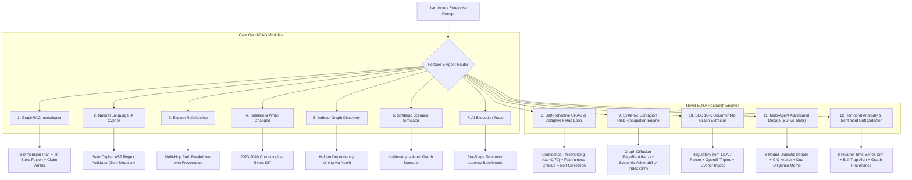

# Advanced SOTA Research Features Specification

**Document Version**: 4.0.0 (SOTA Research Release)  
**Platform**: Autonomous Company Intelligence & GraphRAG Investigation Platform  
**Target Venue**: IEEE Transactions on Knowledge and Data Engineering (TKDE) / IEEE BigData / IEEE ICWS  

---

## 1. Feature Architecture Overview

---

## 2. Core Advanced Modules Specification

### 1. GraphRAG Intelligence Investigator (`/api/v1/investigator/investigate`)
- Autonomous execution of 8-dimension investigation plan (Financial Health, Competitive Landscape, Leadership, Tech Stack, Partnerships, Market Sentiment, Risk, Trajectory).
- Multi-source Evidence Fusion (PostgreSQL + ChromaDB + Neo4j) with weighted confidence scores.
- Claim Verification Engine assigning `Supported`, `Partially Supported`, `Unsupported` with audit drill-down.

### 2. Natural Language to Cypher Studio (`/api/v1/investigator/nl-to-cypher`)
- Converts natural language queries into Cypher statements.
- **Safety Validation**: Strictly rejects destructive Cypher operations (`DELETE`, `DETACH`, `CREATE`, `DROP`, `SET`, `MERGE`, `REMOVE`).

### 3. Explainable Graph Reasoning (`/api/v1/investigator/explain-relationship`)
- Visualizes multi-hop relationship path traces (`Company A ➔ Rel ➔ Entity B ➔ Rel ➔ Entity C`).
- Displays exact safe Cypher query without exposing database secrets.

### 4. Company Intelligence Timeline & What-Changed Diff (`/api/v1/investigator/timeline` & `/what-changed`)
- Tracks verified 2023-2026 historical events linked to evidence IDs.
- Snapshot comparison matrix highlighting metric and relationship changes.

### 5. Graph Discovery Engine (`/api/v1/investigator/graph-discovery`)
- Identifies indirect multi-hop connections (`Company A ➔ Tech X ➔ Company B ➔ Investor Y`) using actual Neo4j paths.

### 6. Strategic Scenario Simulator (`/api/v1/investigator/scenario-simulator`)
- Simulates hypothetical market entries in an isolated in-memory graph state.
- Clearly labeled as `"Hypothetical Simulation — Production Graph Untouched"`.

### 7. AI Investigation Execution Trace (`/api/v1/investigator/trace`)
- Captures stage-by-stage latency (ms), status, result counts, and details.

---

## 3. Cutting-Edge SOTA Research Engines (Novel IEEE Contributions)

### 8. Self-Reflective / Adaptive GraphRAG Loop (CRAG & Self-Correction)
- **Module**: `backend/investigator/crag_self_reflection.py` | `POST /api/v1/investigator/crag-self-reflection`
- **Theoretical Formulation**:
  $$S = w_g \cdot c_g + w_v \cdot c_v + w_s \cdot c_s \quad (w_g=0.45, w_v=0.35, w_s=0.20)$$
  $$\text{Trigger Adaptive Expansion if } S < \tau \quad (\tau = 0.70)$$
- **Capabilities**:
  - Dynamically triggers 3-hop neighborhood expansion in Neo4j to harvest auxiliary triples when confidence is below $\tau$.
  - Executes sentence-level **Faithfulness Critique** evaluating groundedness against graph triples.
  - Automatically identifies hallucinated assertions and generates fact-corrected, triple-cited statements.

### 9. Systemic Supply-Chain & Contagion Risk Propagation Engine
- **Module**: `backend/investigator/contagion_risk_engine.py` | `POST /api/v1/investigator/contagion-risk`
- **Theoretical Formulation**:
  $$E_{i}^{(t+1)} = \alpha \sum_{j \in \mathcal{N}_{in}(i)} W_{ji} \cdot E_{j}^{(t)} + (1-\alpha) E_{i}^{(0)}$$
  $$SVI = \beta \cdot \text{InDegreeExposure} + (1-\beta) \cdot \text{CascadeSensitivity} \in [0, 100]$$
- **Capabilities**:
  - Simulates cascading supply-chain, geopolitical, financial, and cybersecurity shocks from any network epicenter (e.g., TSMC fab bottleneck).
  - Traces 3 chronological stages (Immediate 0-30d, Mid-Term 30-90d, Long-Term 90-180d) with aggregate USD ecosystem loss estimates.
  - Suggests concrete mitigation alternatives (dual-sourcing, reserve inventory, on-prem failovers).

### 10. Automated SEC 10-K / 10-Q Filing Document-to-Graph Extractor
- **Module**: `backend/investigator/doc_graph_extractor.py` | `POST /api/v1/investigator/extract-filing`
- **Capabilities**:
  - Regulatory section parser extracting Item 1 (Business), Item 1A (Risk Factors), Item 7 (MD&A).
  - OpenIE & NER engine extracting structured triples: `(Company)-[:DEPENDS_ON]->(Supplier)`, `(Company)-[:COMPETES_WITH]->(Competitor)`, `(Company)-[:EXPOSED_TO_RISK]->(RiskFactor)` with confidence scores.
  - Automated generation of production-ready Neo4j Cypher ingestion statements (`MERGE (s:Company...)...`).

### 11. Multi-Agent Adversarial Debate System (M&A Due Diligence)
- **Module**: `backend/investigator/adversarial_debate.py` | `POST /api/v1/investigator/adversarial-debate`
- **Capabilities**:
  - Implements a 3-round dialectic game between a **Bullish Investment Analyst Agent** (TAM growth, synergy, tech moat) and a **Bearish Risk Officer Agent** (regulatory antitrust hold-up, valuation compression, integration capex).
  - Moderated by a **Chief Investment Officer (CIO) Arbiter Agent** who cross-examines claims using knowledge graph triples.
  - Generates a binding **Executive Due Diligence Memorandum** with final verdict (`STRONG_BUY`, `PROCEED_WITH_STRICT_CONDITIONS`, `REJECT_DEAL`), deal feasibility %, recommended valuation discount %, and key conditions precedent.

### 12. Cross-Entity Temporal Anomaly & Financial-Sentiment Drift Detector
- **Module**: `backend/investigator/anomaly_drift_detector.py` | `GET /api/v1/investigator/temporal-drift/{company}`
- **Theoretical Formulation**:
  $$\text{Drift Gap } \Delta(t) = \text{Norm}(Sentiment(t)) - \text{Norm}(FinancialHealth(t))$$
  $$\text{Flag Anomaly if } |\Delta(t)| > 0.45$$
- **Capabilities**:
  - Correlates 8-quarter chronological news sentiment and executive call tone against reported quarterly financials (YoY Revenue %, Operating Margin %).
  - Flags divergence episodes: **Bull Trap Divergence** (euphoric sentiment alongside decelerating revenues) and **Silent Growth Divergence** (contrarian margin resilience during negative media cycles).
  - Full multi-hop graph provenance tracking for every alert.
