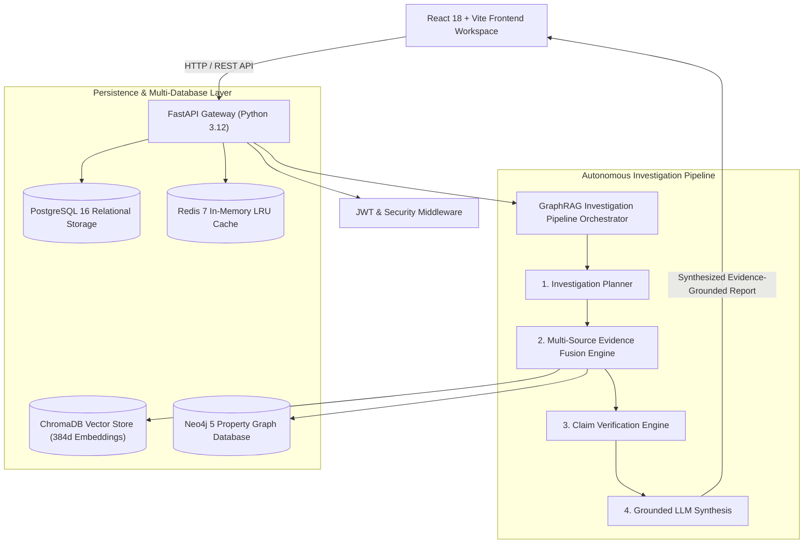
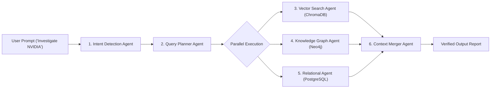
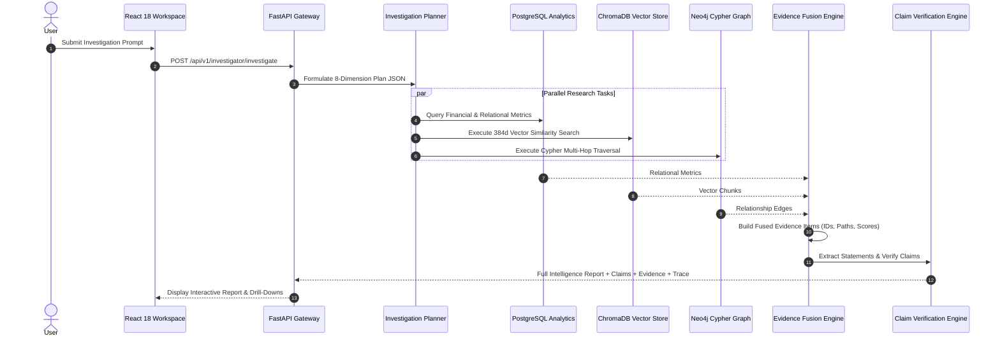
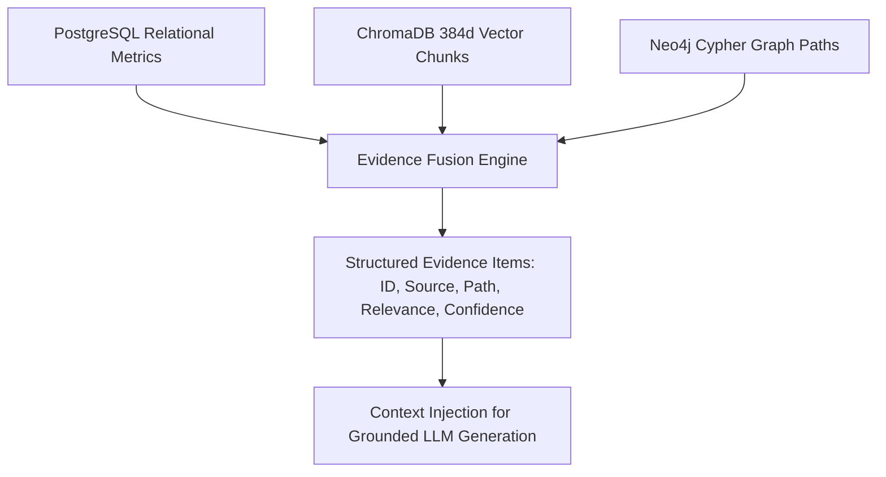
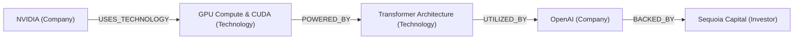
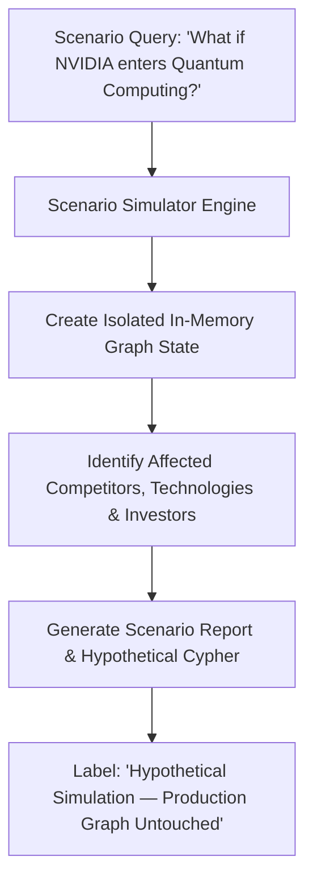
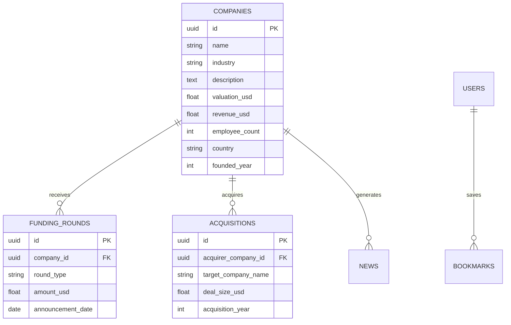

# System Architecture & Technical Diagrams

This document contains complete Mermaid.js UML, ER, Knowledge Graph, Sequence, Evidence Fusion, Claim Verification, Graph Reasoning, and Scenario Simulation diagrams for the **Autonomous Company Intelligence & GraphRAG Investigation Platform**.

---

## 1. System Architecture Diagram



---

## 2. Agent Architecture Diagram



---

## 3. Investigation Sequence Diagram



---

## 4. Evidence Fusion Architecture Diagram



---

## 5. Claim Verification Flow Diagram

```mermaid
flowchart LR
    A[Generated LLM Statement] --> B[Claim Verification Engine]
    B --> C{Match Against Fused Evidence}
    C -->|≥ 2 Sources Match| D[Supported (Green)]
    C -->|1 Source Matches| E[Partially Supported (Amber)]
    C -->|0 Sources Match| F[Unsupported (Red)]
```

---

## 6. Knowledge Graph Reasoning Diagram



---

## 7. What-If Strategic Scenario Simulation Diagram



---

## 8. PostgreSQL Relational ER Diagram


