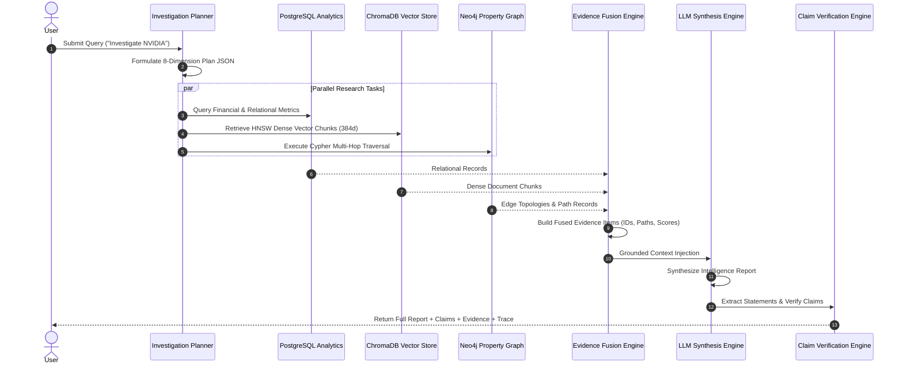

# GraphRAG Investigation Pipeline Specification

**Document Version**: 3.0.0  
**Status**: Multi-Stage Autonomous Investigation Architecture  

---

## 1. Sequence & Stage Architecture



---

## 2. 8-Dimension Structured Investigation Plan JSON

```json
{
  "company_profile": true,
  "financial_analysis": true,
  "technology_analysis": true,
  "competitor_analysis": true,
  "investor_analysis": true,
  "leadership_analysis": true,
  "risk_analysis": true,
  "relationship_analysis": true
}
```

---

## 3. Multi-Source Evidence Schema

```json
{
  "evidence_id": "ev_4f82a10",
  "source_type": "knowledge_graph",
  "source": "Neo4j",
  "path": "NVIDIA → [USES_TECHNOLOGY] → CUDA",
  "retrieved_content": "Graph Relationship: NVIDIA → [USES_TECHNOLOGY] → CUDA",
  "relevance_score": 0.92,
  "confidence": 0.95,
  "timestamp": "2026-09-25T10:30:00Z"
}
```
